

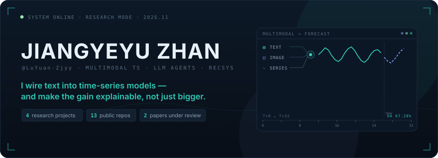

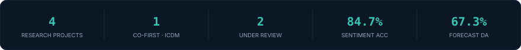

 

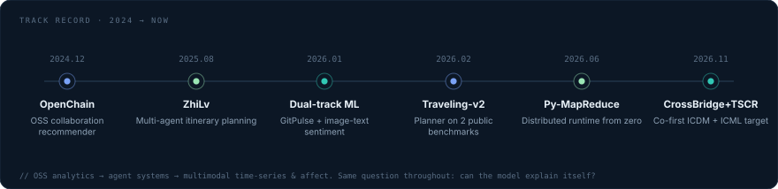

 

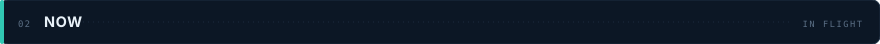

- 🔬 **TSCR — in progress (ICML target).** Text should not enter a forecaster through one shared gate. I decompose the series into trend / season / event / residual and inject each text component at a different layer (input, parameter, structure, output).
- 📄 **CrossBridge — submitted (ICDM 2026, co-first).** Multi-prototype + uncertainty transfer for cold-start cross-domain recommendation: negative transfer cut to 1/3 across 4 Amazon domains.
- 🛠 **factguardian — building.** Agent for long-document fact consistency: LLM extraction, LSH dedup, semantic indexing, image-text cross-checking, one-command deploy.

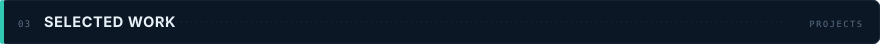

<a href="https://github.com/LuYuan-Zjyy/GitPulse">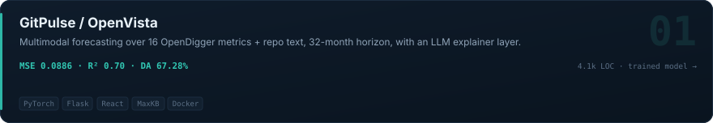</a>  
<a href="https://github.com/LuYuan-Zjyy/InteractiveFusion-Sentiment">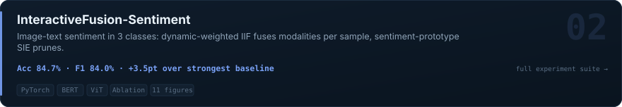</a>  
<a href="https://github.com/LuYuan-Zjyy/factguardian">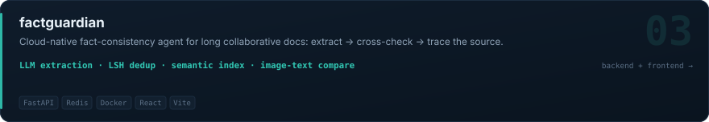</a>

 

&nbsp;&nbsp;<a href="https://github.com/LuYuan-Zjyy/OpenChain">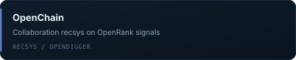</a>  
<a href="https://github.com/LuYuan-Zjyy/Py-MapReduce">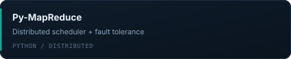</a>&nbsp;&nbsp;<a href="https://github.com/LuYuan-Zjyy/Bookstore">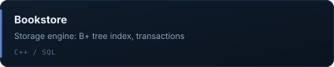</a>

 

| Work | Role | Status | Key result |
| :--- | :--- | :--- | :--- |
| **CrossBridge** · cold-start cross-domain rec | co-first | submitted · ICDM 2026 | multi-prototype + uncertainty bridge, negative transfer → 1/3 |
| **TSCR** · text injection for time-series | first | in progress · ICML target | closed T+S+C+R decomposition + four-layer heterogeneous injection |
| **InteractiveFusion-Sentiment** · image-text affect | solo | complete experiments | 84.7% acc / 84.0% F1, +3.5pt over strongest baseline |
| **Deepfake audio detection** · dual-branch Conformer | third | under review · Applied Soft Computing | envelope + resonance branches, lower EER on CFAD |

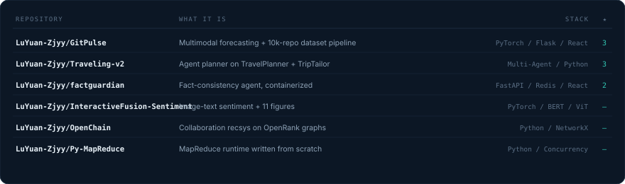

**13 public repositories** — dataset pipeline, model, service and evaluation harness, all in the open. Public benchmarks are reproduced locally, not quoted from papers.

 

    
    
    
    

 

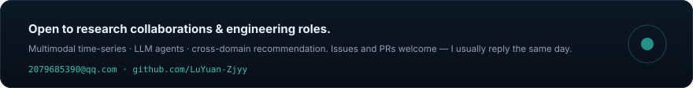

Everything above is code you can read — start from the pinned repos. Last update 2026.11

